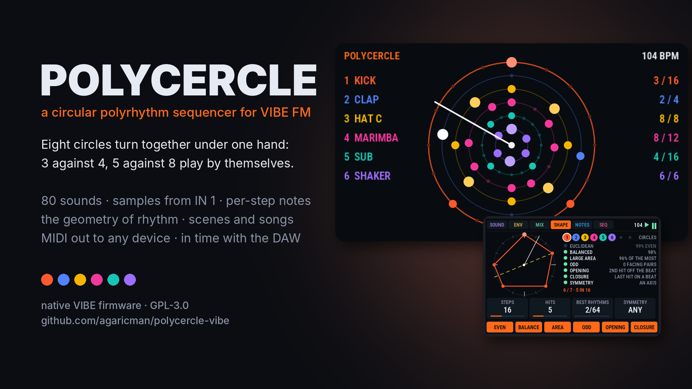
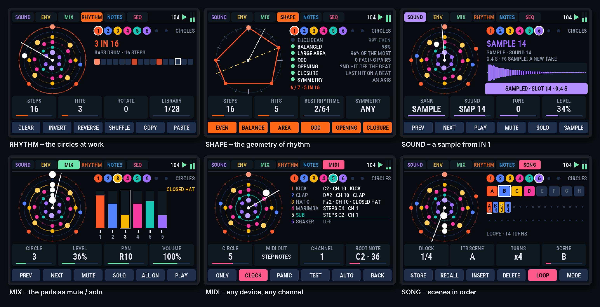

# POLYCERCLE for VIBE FM

**A circular polyrhythm sequencer.** Up to eight concentric circles turn together under one hand. A circle of
*n* steps spreads its hits evenly over one turn, so 3 against 2, 5 against 4 or 7 against 8 play by themselves –
each circle with its own sound, its own notes and its own MIDI destination.



Polycercle began as a web page (rhythm-circle.com, improved), became a firmware for the M-VAVE FM-1, and is now a
native VIBE FM firmware: the same patterns, songs and voices, on the full 480 × 320 screen, in your DAW and in the
browser.

## What it does

- **Eight circles, 1–48 steps each**, one shared turn (1–16 beats per turn, 30–300 BPM, swing).
- **80 sounds in five banks:** an 808 kit (the FM1 Open drum voices: DaisySP / Plaits models), basses, new-age bells
  and bowls, world percussion, synth. Tune, decay, tone, drive, level and pan per circle.
- **A SAMPLE bank recorded from IN 1:** sixteen slots. Arm one (SOUND → F6 SAMPLE), play into the input: the sound is
  caught as it starts, trimmed, normalised and kept – then it plays on any circle, at any pitch, with the circle's
  decay, tone and drive. (In the browser the computer's input, in the DAW the plugin's input.)
- **Per-step notes:** a transposition (−16…+15 semitones) and a length (free, 1/16 … whole) on every step; play them
  in from the keys.
- **A rhythm library** (tresillo, son clave, bembé, aksak, clapping music…), **Euclidean** hits, rotation, invert,
  reverse, shuffle, copy / paste (OCT − / + copy a circle onto another one).
- **SHAPE – the geometry of rhythm:** a circle's rhythm drawn as the polygon it inscribes, measured on the seven
  properties of Godfried Toussaint's *The Geometry of Musical Rhythm* (evenness, balance, area, rhythmic oddity,
  opening, closure, symmetry), and a generator that ranks every rhythm of *k* hits on *n* steps for the properties
  you ask for – ask for all of them on 16 steps and the son clave comes out on top.
- **Eight scenes and a song** of up to 32 blocks (scene × turns), looping or not.
- **MIDI out, per circle, to any device:** one note on every hit (a drum machine – General MIDI notes on channel 10
  suggested – or a sampler pad) or the step notes from a root (a bass line, a melody), any channel, optionally silent
  inside Polycercle. Sample-exact note-ons, MIDI clock and START / STOP.
- **Follows the DAW** (and a MIDI clock on the VIBE and in the browser): its tempo and song position, loops and
  jumps included – the circles land on the beat, sample-exact.
- **Eight song slots** and an automatic save; in the plugin everything lives in the DAW project.

## VIBE features used

- the **480 × 320 screen**: the circles, the steps of the selected circle, four values, six soft keys
- the **16 pads**: the steps of the selected circle (16 a page), hard hits = accents, lit in the circle's colour;
  on MIX a mute / solo mixer for the eight circles
- the **four knobs** (and A = the circle, B = its sound), **K1–K6** pages in the house layout
- the **audio input IN 1**: sampling into sixteen slots, with an input meter and a trigger level
- the **25 keys**: play the circle chromatically, step entry on NOTES, live recording into the circle (REC);
  OCT − / + copy and paste circles
- the **DAW's song position** and tempo (SDK 8 / 27), **DAW parameters** with mixer convention (SDK 11) and an
  Editor with one tab per circle (C1–C8)
- **MIDI out** with sample-exact note-ons and **MIDI clock out** (SDK 9)
- the **stage** (SDK 23): the circles, big, in the plugin's and the browser's window
- **FOCUS** (ENTER held or SHIFT + DATA: every control on the display) and clicks into the display (SDK 10 / 18)
- the host's sample rate (44.1 / 48 / 96 kHz …): every voice is recomputed for it, nothing resampled



## Controls

| Control | Does |
|---|---|
| **K1 SOUND** | bank, sound, tune, level · soft keys: previous / next circle, hear it, mute, solo, reset (SAMPLE bank: record from IN 1) |
| **K2 ENV** | decay, tone, drive, pan |
| **K3 MIX** | circle, level, pan, master volume · previous / next, mute, solo, all heard · pads 1–8 mute, 9–16 solo |
| **K4 RHYTHM** | steps, hits (Euclidean), rotate, library · clear, invert, reverse, shuffle, copy, paste |
| SHAPE (K4 again) | steps, hits, best rhythms, symmetry · F1–F6 the properties asked: even, balance, area, odd, opening, closure |
| **K5 NOTES** | step, pitch, length, hit · keys put their note into the step and move on |
| **K6 SEQ** | tempo, beats per turn, swing, circles (1–8) · tap, SONG, MIDI, SLOTS, undo, save |
| SONG (from SEQ) | block, its scene, turns, scene · store, recall, insert, delete, loop, mode (PLAY plays the song) |
| MIDI (from SEQ) | circle, MIDI out (off / note / step notes), channel, note · MIDI only, clock, panic, test, auto |
| SLOTS (from SEQ) | eight song slots · load, save, the demo |
| Encoder A / B | the circle / its sound |
| Pads | the steps (hard hit or SHIFT = accent) · − / + the next 16 steps |
| Keys | play the circle · REC + PLAY: record into it, on the nearest step |
| OCT − / + | copy the circle / paste it into the selected one (its MIDI route stays) |
| PLAY / STOP | the circles, or the song (SONG → MODE). While a DAW or a MIDI clock plays, it leads: STOP holds Polycercle silent, PLAY brings it back in at the DAW's position |
| DATA | the rhythm library on the selected circle, from any page (the FM-1's PRESETS knob) |
| HOME | what every control does on this page |

## The demo

At the first start: a groove in C minor pentatonic at 104 BPM – a tresillo kick, a clap on 2 and 4, swung hats, a
marimba of 12 steps and a shaker of 6 turning 3 against the 4 beats, a bass that follows the kick – in a looping
song (groove, lift, break, lift), and a scene D of pure polyrhythm (3, 4, 5, 7) to explore. SLOTS → DEMO brings it back.

## Build

Every push is built on GitHub with the SDK's own toolchain and checked by `vibe-check`
(`.github/workflows/build.yml`); a published release gets `polycercle.wasm` and `polycercle.zip` attached. By hand:

```sh
# in a clone of the VIBE FM SDK, with Zig 0.13.0, this repository in firmwares/polycercle
sh tools/build.sh firmwares/polycercle
node tools/vibe-check.mjs build/polycercle.wasm --manifest firmwares/polycercle/firmware.json
```

Drop `build/polycercle.zip` onto the VIBE FM VST window, or the `.wasm` onto the Playground
(<https://play.thefirmwarehub.com/>).

## Credits and licence

- The seven properties and the generator follow Godfried Toussaint, *The Geometry of Musical Rhythm* (2013).
- The rhythm circle: The Rhythm Circle (Paul Lascabettes and Corentin Guichaoua, Mathémusique).
- Polycercle: GPL-3.0-only (see `LICENSE`).
- Drum voices (`poly_drums.c`): from the FM1 Open SDK 808 kit – DaisySP (Electrosmith), Plaits (Emilie Gillet),
  M-VAVE – under the MIT licence (`THIRD_PARTY.md`).
- Built on the VIBE FM SDK (Apache-2.0) by Sven Trogus (zvenson), The Firmware Hub.
